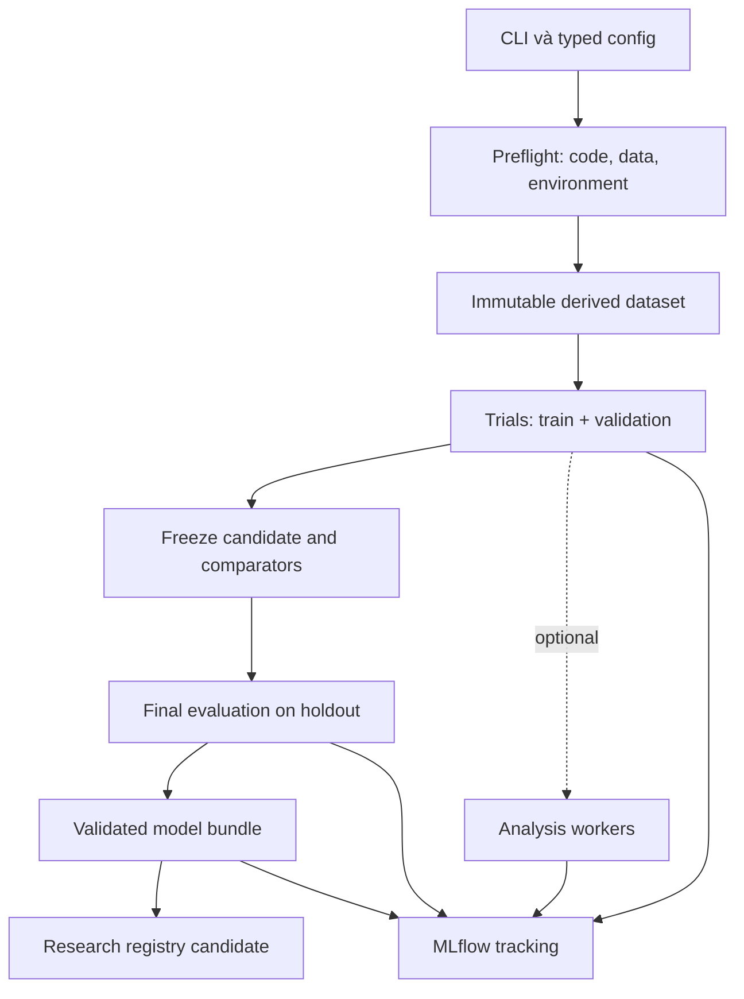

# 01. Kiến trúc và hợp đồng thực thi

## 1. Kiến trúc mục tiêu

**[Confidence: Medium — thiết kế module cho quy mô dự án hiện tại.]** Một package training có dependency tối thiểu; MLflow là service riêng. Runner điều khiển stage và xử lý lỗi. Registry giữ model version; serving tải bundle đã chọn. Không dùng MLflow run status thay cho scheduler/checkpoint của ứng dụng.



Diagram mô tả quan hệ, không yêu cầu `train` tự động chạy test và promote. CLI tách các thao tác để khóa holdout và làm promotion reviewable.

## 2. Cấu trúc code cần tạo

Các đường dẫn dưới đây là **đích implementation**. Chúng chưa được tạo bởi công việc viết specs.

| Path | Trách nhiệm |
|---|---|
| `pipeline/pyproject.toml`, `pipeline/uv.lock` | Package, console entrypoint `surge-ml`, groups, locks |
| `pipeline/src/surge_ml/cli.py` | Parse commands, config overrides hữu hạn, exit codes |
| `.../config.py` | Pydantic schema, cross-field validation, resolved config/hash |
| `.../contracts.py` | Dataclasses/protocols và version compatibility |
| `.../orchestration/runner.py` | Stage DAG, transitions, deadlines và cancellation |
| `.../orchestration/state.py` | Atomic run state, attempt ownership, local lock |
| `.../data/resolve.py` | Source pointer/path/identity/hash checks |
| `.../data/derive.py` | Project/validate Parquet nguồn, dựng mmap derivative, V12 target/masks/index/train-only norm |
| `.../data/dataset.py`, `.../data/batch.py` | Memory map arrays, materialize minibatch, graph offsets |
| `.../data/validation.py` | Schema/time/graph/data-quality gates |
| `.../models/dual_gru_gatv2.py` | Forward thuần; không đọc config/files hoặc log MLflow |
| `.../models/baselines.py` | Persistence, pointwise GRU, LGBM; adapters độc lập |
| `.../training/losses.py`, `trainer.py`, `checkpoint.py` | Masked losses, optimizer loop, best/last/resume |
| `.../evaluation/metrics.py`, `selection.py`, `finalize.py` | Forecast metrics, frozen selection, test receipt |
| `.../tracking/mlflow_adapter.py` | Client explicit run ID, params/metrics/artifacts |
| `.../artifacts/bundle.py`, `export.py`, `verify.py` | Bundle manifest, eager/pt2 export, parity |
| `.../registry/service.py` | Candidate registration, promotion/rollback receipt |
| `.../analysis/registry.py`, optional plugins | Subprocess SHAP/permutation/EDA/benchmark/report |
| `.../inference/forecast.py`, `controller.py` | Versioned inference adapter, pure controller |
| `.../legacy/adapter.py` | Explicit replay source contract cũ, không ngầm cast sang v12 |
| `pipeline/configs/`, `pipeline/infra/`, `pipeline/tests/` | Config chính thức, Docker, kiểm tra yêu cầu |

Import rule: `models/losses/metrics` không import MLflow, CLI, filesystem hoặc SHAP. `orchestration` gọi interfaces; `tracking` không import data builder/model internals. Research packages chỉ import bên trong plugin được bật. `controller` không tham gia backward.

## 3. Hợp đồng module

```python
# Signatures yêu cầu, không phải mã đã triển khai.
resolve_source(config: DataConfig) -> SourceDatasetRef
validate_source(source: SourceDatasetRef) -> ValidationReport
derive_dataset(source: SourceDatasetRef, spec: DerivationSpec) -> DerivedDatasetRef
make_split(dataset: DerivedDatasetRef, split: str) -> DatasetView
collate_graphs(samples: list[GraphSample]) -> GraphBatch
train_trial(config: TrainConfig, data: TrainValViews, tracking: TrackingSink) -> TrialResult
evaluate(model: ForecastModel, data: DatasetView, policy: EvaluationPolicy) -> EvaluationResult
freeze_selection(trials: list[TrialResult], policy: SelectionPolicy) -> SelectionReceipt
finalize(selection: SelectionReceipt, holdout: HoldoutView) -> FinalEvaluationReceipt
build_bundle(trial: TrialResult, evidence: EvidenceRefs) -> BundleRef
verify_bundle(bundle: BundleRef, runtime: RuntimeProfile) -> VerificationReport
register_candidate(bundle: BundleRef, final_eval: FinalEvaluationReceipt) -> ModelVersionRef
```

`SourceDatasetRef` chứa path thực tế, manifest identity, source layout/schema hash, Parquet inventory/checksum map, `source_parquet_sha256`, contract hash và dataset kind; training checksum map legacy là audit/replay reference riêng. `DerivedDatasetRef` chứa parent fingerprints đúng scope, target/window/split/feature/graph versions, normalizer hash và artifact paths. `TrialResult` MUST chứa trained weights path, best epoch, valid selection metric, prediction coverage, attempt IDs; không trả model chưa có checkpoint thành công.

`GraphBatch` phân hai boundary: `inputs` gồm x/edge_index/edge_attr/node mapping; `supervision` gồm target, mask, optional diagnostic future volume. `ForecastModel.forward` chỉ nhận `inputs`. Không truyền toàn bộ batch có y/future volume để model tùy ý đọc.

## 4. Stage contracts

| Stage | Input | Output bền vững | Điều kiện success |
|---|---|---|---|
| `preflight` | Config, source path, requested device | resolved config, code/env report | Schema, identities, disk/device/tracking pass |
| `validate_source` | Manifest/contracts/payload list | source_validation.json | Hashes/schema/time/shape đúng |
| `derive` | Source ref + versioned transform | temp -> finalized derived dataset | Target/mask/index/norm checks và manifest hash pass |
| `train` | Train/val views, model config | last/best checkpoint, epoch log | Có checkpoint best hợp lệ; no finite violation |
| `validate` | Best checkpoint + fixed val mask | val predictions/metrics | Full eligible coverage, comparisons reproducible |
| `select` | Validation leaderboard | immutable selection/selected_model.json | Candidate/comparators/configs frozen |
| `finalize` | Selection + holdout ref | final_eval.json, test predictions | Chỉ frozen candidates; eval receipt độc nhất |
| `package` | Best weights + contracts + evidence | immutable bundle directory | Reload parity/schema/hash completeness |
| `analyze` | Bundle + sampled train/val data | per-analysis report/status | Plugin success; failure không xóa core |
| `register` | Qualified bundle + final evaluation | registry version + receipt | Tracking synced, gates pass, đúng research namespace |

`train` không gọi `finalize` như side effect. `package` MAY tạo research bundle trước holdout với `quality_status=UNASSESSED`; `register` trong workflow mặc định cần final evaluation. `.pt2` failure không làm eager bundle biến mất nhưng `export_status=FAILED` và không cho chọn serving format pt2.

## 5. Trạng thái và durable state

Pipeline business status tách khỏi MLflow API status:

| Trạng thái ứng dụng | Ý nghĩa | MLflow khi đã sync |
|---|---|---|
| `CREATED`, `PREFLIGHT`, `VALIDATING`, `DERIVING`, `TRAINING`, `EVALUATING`, `PACKAGING` | Đang thực thi | `RUNNING` |
| `SUCCEEDED` | Core required artifacts/gates hoàn tất | `FINISHED` |
| `SUCCEEDED_WITH_WARNINGS` | Core hoàn tất, optional stage lỗi/skip | `FINISHED`, warning tags |
| `FAILED` | Stage critical lỗi | `FAILED` |
| `CANCELLED` | Người vận hành dừng có kiểm soát | `KILLED` |
| `INTERRUPTED` | Process chết/mất worker, cần reconcile | Reconciler đánh dấu `FAILED` khi xác minh |

Model quality có trường riêng `UNASSESSED/PASSED/FAILED`; một run SUCCEEDED có thể có model quality FAILED vì không thắng baseline. `tracking_sync=PENDING/COMPLETE/FAILED` và `export_status=NOT_REQUESTED/PASSED/FAILED` cũng độc lập. Nếu pipeline không upload được required evidence thì không đánh dấu SUCCEEDED.

Mỗi attempt có `runs/<pipeline_run_id>/attempts/<attempt_id>/state.json`, stage timestamps UTC, monotonically increasing revision, last durable checkpoint, artifact receipts, sanitized error kind và traceback path. Ghi file tạm cùng filesystem -> flush/fsync -> atomic replace; ownership lock `O_EXCL` theo run. Heartbeat 30s; stale sau 180s là dấu hiệu cần reconcile, không tự cướp một lock còn chủ sống.

V1 chạy trên một worker; local locks không cung cấp mutual exclusion giữa nhiều máy. Khi dùng shared/team controller, CLI mutations đi qua một management worker có khóa trung tâm. Không dùng việc thấy một MLflow run RUNNING để giả lập distributed lock.

## 6. Retry, resume và idempotency

- `request_id` do CLI tạo/nhận, map sang pipeline execution trong run catalog. Lặp lại cùng request_id + config/data identity trả về execution hiện có; khác identity trả `IDEMPOTENCY_CONFLICT`.
- Stage output chỉ được reuse khi source/config/contract/code hash phù hợp và manifest có trạng thái finalized. Không tin riêng tên folder hoặc `_SUCCESS` chưa có hashes.
- Retry I/O/network: lần đầu cộng tối đa 3 retries (4 attempts tổng), exponential delays 1/2/4s cộng jitter. Không retry schema mismatch, corrupt hash, invalid target hoặc CUDA OOM bằng cách tự đổi batch size.
- Resume mặc định ở **epoch boundary** từ `last` checkpoint, tạo MLflow child attempt mới, giữ lineage tới attempt cũ. Resume không có nghĩa mở lại run bằng API MLflow rồi chạy epoch 1.
- Resume MUST restore weights/optimizer/scheduler/AMP/RNG/shuffle generator và next_epoch. Mất vài minibatch cuối khi process crash là hành vi chấp nhận được; ghi epoch boundary đã durable.
- Thay batch size, feature subset, transform, loss, optimizer hoặc source tạo trial mới; không giả là continuation y hệt.
- Cancel được kiểm tra sau mỗi optimizer step và ở boundary stage; checkpoint trước khi kết thúc nếu trạng thái còn finite. Không ghi `best` từ state hỏng.

## 7. Critical path và optional workers

Critical: data validation, derivation, model training, valid checkpoint, core validation, eager reload parity, required artifact manifest và tracking receipts. Failure ở đây trả exit nonzero.

Optional analysis chạy trong subprocess có environment rõ, time/memory limits, input sample được ghi hash. `ImportError`, timeout hoặc unsupported architecture -> status `SKIPPED`/`FAILED` với lý do. Chỉ lỗi môi trường phân tích được degrade; lỗi integrity trên input đã dùng để train phải raise core integrity failure.

Chi tiết từng analysis plugin theo [11_post_training_analysis.md](11_post_training_analysis.md). Default analysis dùng train/val. Report tổng hợp core metrics không cần Quarto; fallback Markdown/JSON vẫn được tạo. tsfresh output không tự thêm vào feature training của run hiện tại; muốn thêm phải tạo feature contract, split fitting và trial mới. AutoGluon plugin khám phá không thay thế các comparator bắt buộc trong 04.

## 8. Quản lý dữ liệu và run catalog

Không xây database ứng dụng mới cho epoch metrics. MLflow giữ searchable tracking; dataset manifest/bundle là nguồn byte identity; local catalog JSONL/SQLite nhỏ giữ CLI request IDs, attempts, sync receipts và promotion lock của worker. Không ghi trực tiếp vào tables nội bộ MLflow.

Người dùng cần truy vấn được: run đang chạy/lỗi, stage cuối, source dataset, feature/target version, seed/device, config differences, best validation, selected-test receipt, candidate/champion và bản trước. `surge-ml runs list/show/compare` và MLflow UI đáp ứng các tác vụ này; xem 03/05.

## 9. Study aggregate và prepare boundary

Study parent là aggregate record có WAITING_SELECTION/WAITING_FINALIZE theo [10](10_benchmark_and_study_contract.md), không có worker heartbeat. Stale/reconcile rules ở05 chỉ áp attempts có worker. Trusted `prepare` materialize/seal holdout một cách deterministic; `train` chỉ mở prepared TrainValViews. Nếu chưa có derivative, trả PREPARE_REQUIRED và yêu cầu chạy prepare command đã xác định, không tạo test labels trong trainer.
