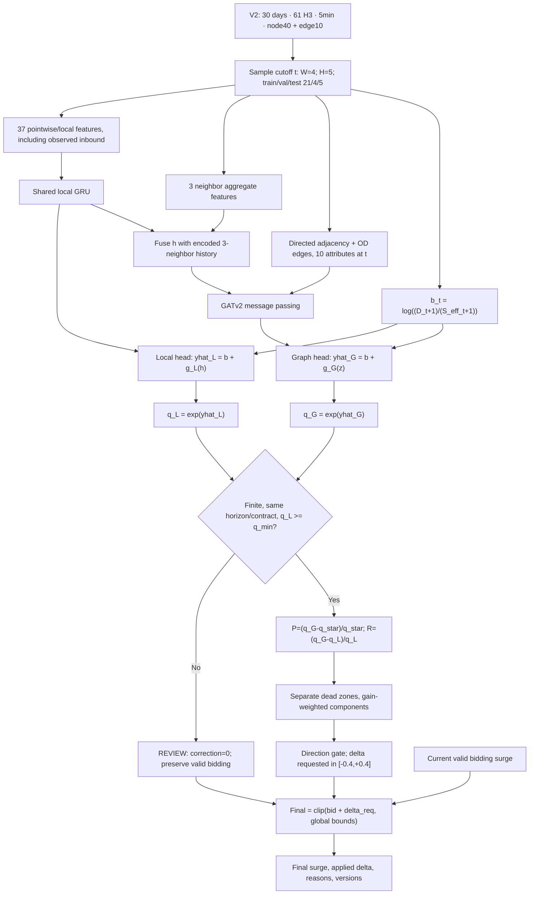
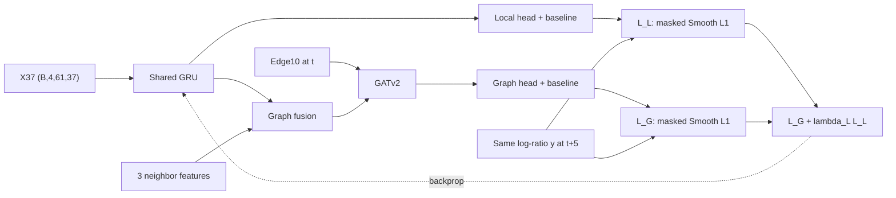

# Technical Report

**Dự án:** graph_surge_pricing  
**Phiên bản tài liệu:** 1.2 / 2026-10-09  
**Loại:** thiết kế kỹ thuật để triển khai và kiểm chứng, không phải báo cáo kết quả thực nghiệm  
**Phạm vi:** model, graph, target, loss, gradient, post-processing và correction trên bidding  
**Code/data tham chiếu:** V2 release `data/hcm_data_2`, `data/CURRENT.json`, `feature_contract.json`, `mock_data_pipeline/surge_mock/feature_v2.py`, các bản legacy lưu tại `data/hcm_data_2/provenance/pipeline/`.  
**Phạm vi sửa đổi:** chỉ cập nhật trực tiếp file `docs/model/technical_report.md`; không sửa generator, dataset, training code hoặc checkpoint.

> **Contract chính V1.2 theo V2:** target `log((D+1)/(S_eff+1))`, inverse `exp`, window 4, node40/edge10, `gru_local37`/`gru_gatv2_40`, H=5 phút, split 21/4/5 ngày. Dual-head và controller post-processing đã có trong package ở chế độ nghiên cứu DEMO/SHADOW; chưa được calibration, chưa benchmark lại trên dataset `CURRENT` và chưa có chứng cứ cải thiện kinh doanh. Giữ nguyên tên tài liệu **Technical Report**.

## Mục lục

1. [Bối cảnh và mục tiêu](#1-bối-cảnh-và-mục-tiêu)
2. [Nguồn và ranh giới bằng chứng](#2-nguồn-và-ranh-giới-bằng-chứng)
3. [Idea và quyết định kiến trúc](#3-idea-và-quyết-định-kiến-trúc)
4. [Pipeline end-to-end](#4-pipeline-end-to-end)
5. [Ký hiệu và data contract](#5-ký-hiệu-và-data-contract)
6. [Thiết kế graph](#6-thiết-kế-graph)
7. [Temporal encoder và prediction heads](#7-temporal-encoder-và-prediction-heads)
8. [Ground truth và loss function](#8-ground-truth-và-loss-function)
9. [Gradient và hội tụ](#9-gradient-và-hội-tụ)
10. [Controller sau khi có hai D/S](#10-controller-sau-khi-có-hai-ds)
11. [Ví dụ số và các trường hợp biên](#11-ví-dụ-số-và-các-trường-hợp-biên)
12. [Tính chất toán học và giới hạn](#12-tính-chất-toán-học-và-giới-hạn)
13. [Training và evaluation protocol](#13-training-và-evaluation-protocol)
14. [Serving, explainability và audit](#14-serving-explainability-và-audit)
15. [Kế hoạch triển khai và acceptance tests](#15-kế-hoạch-triển-khai-và-acceptance-tests)
16. [Rủi ro và quyết định còn mở](#16-rủi-ro-và-quyết-định-còn-mở)
17. [Công thức tổng hợp](#17-công-thức-tổng-hợp)
18. [Tài liệu tham chiếu](#18-tài-liệu-tham-chiếu)

## 1. Bối cảnh và mục tiêu

Theo chủ dự án, bidding/surge hiện tại đang hoạt động tốt và có lợi nhuận; tác động đến cân bằng marketplace chưa được xác minh. Vì vậy không kết luận bidding đã xử lý shortage, cũng không kết luận nó chắc chắn thất bại trong việc đó. Module mới chỉ đưa ra độ điều chỉnh trên bidding mới nhất. Đây là bối cảnh do người dùng cung cấp, không phải kết quả kinh doanh được repository chứng minh.

Với mỗi hex i ở thời điểm t, hệ thống nhận giá nền `s_bid(i,t)` và đề xuất:

$$
\Delta s^{req}_{i,t}\in[-0.4,+0.4].
$$

Giá đề xuất cuối cùng là:

$$
s^{final}_{i,t}=\operatorname{clip}(s^{bid}_{i,t}+\Delta s^{req}_{i,t},s_{min},s_{max}).
\tag{1}
$$

Biên độ ±0.4 là yêu cầu correction của người dùng, không phải kết luận từ paper. Không âm thầm thay global cap để bảo đảm luôn dùng đủ biên độ này.

Câu chuyện sản phẩm: **Pressure cho biết forecast cuối lệch reference bao nhiêu; Relative Graph Revision làm correction mạnh hơn hoặc nhẹ hơn theo chênh lệch giữa forecast graph và local. Bidding vẫn là giá nền.**

[Confidence: Cao — mô tả yêu cầu và định nghĩa toán học; Trung bình — mức độ hiệu quả của policy chưa được thực nghiệm xác nhận.]

Không thuộc phạm vi V1.2: reward model, tối ưu GMV bằng argmax, RL/MPC, causal network-effect estimation, tự đổi bidding engine, bảo đảm lợi nhuận hoặc chứng minh D/S phải về 1. Không có kết quả MAE, latency hay uplift mới được tạo trong công việc viết tài liệu này.


## 2. Nguồn và ranh giới bằng chứng

| Nguồn | Giá trị bằng chứng | Giới hạn |
|---|---|---|
| S1: tài liệu kiến trúc V1 của người dùng | Ý tưởng local/graph heads, GRU/GATv2, Pressure và GraphEffect, loss ban đầu | Không phải schema của V2 |
| S2: quyết định V1.2 trong hội thoại | Controller Pressure + Revision, dead zones riêng, direction gate và correction ±0.4 | Policy engineering, không phải giá tối ưu đã chứng minh |
| C-V2: `data/hcm_data_2/meta/feature_contract.json`, `meta/manifest.json`, `mock_data_pipeline/surge_mock/feature_v2.py` | Node40/edge10 và dữ liệu point-in-time | Source không sở hữu target/window/index training; pipeline W4 tạo target và sample index `a+14` downstream |
| C-legacy: `data/hcm_data_2/provenance/pipeline/` | Adapter/train/model được lưu khi tạo release, persistence residual `b+g` | Chưa phải dual-head V1.2 và không phải entrypoint training hiện hành |
| C-validation: `data/hcm_data_2/reports/` | Report kỹ thuật raw/feature, smoke tests | Không chứng minh uplift hoặc graph tốt hơn local |

Nguyên tắc chứng cứ: công thức có thể **đúng về toán học** nhưng mapping sang giá vẫn **chưa calibration**. Forecast Revision không phải causal network effect. Dataset `training_ready` nghĩa là hợp đồng kỹ thuật/payload đã từng được kiểm tra, không đồng nghĩa deploy-ready hay dual-head model đã chạy. Các thông số ví dụ của controller không phải tham số tối ưu.

Các nghiên cứu R1–R7 hỗ trợ GRU, GATv2, SmoothL1, kỹ thuật điều khiển dead zone, backpropagation và chronological validation; không paper nào ở đây chứng minh các gain `k_press`, `k_rev` là tối ưu cho HCMC V2.

## 3. Idea và quyết định kiến trúc

### 3.1. Vì sao cần graph?

Dữ liệu network cung cấp trạng thái vùng kết nối, cấu trúc OD, thông tin chuyến đến/rời và thời gian di chuyển. H3 là cách định danh node; riêng việc có H3 không chứng minh graph hữu ích. GNN phải được kiểm chứng bằng so sánh ngoài mẫu với baseline chỉ dùng thông tin tabular/local.

GATv2 được chọn vì giữ được cấu trúc temporal-then-graph đang có trong S1 và trong họ model hiện tại. Paper R2 hỗ trợ attention động phụ thuộc query node; nó không hứa hẹn cải thiện trên mọi dataset. [Confidence: Cao về đặc tính GATv2 — R2; Trung bình về lựa chọn cho marketplace này.]

### 3.2. Hai forecast cùng ground truth không phải mâu thuẫn

Local và graph cùng cố dự báo DS ở t+5. Khác biệt là tập thông tin và đường tính toán. Nếu cả hai dự báo đúng, chúng có thể gần bằng nhau. Không thiết kế loss ép chênh lệch khác 0 chỉ để có một network contribution lớn.

S1/S2 gọi chênh lệch này là GraphEffect/Graph Revision. Trong báo cáo, dùng **Relative Graph Revision** để nhấn mạnh đây là thay đổi dự báo, không phải tác động nhân quả. Hai head khác nhau còn có thể tạo chênh lệch do capacity, optimization và calibration; shared encoder không loại bỏ hoàn toàn những yếu tố đó.

[Confidence: Cao — hệ quả của cấu trúc model và định nghĩa chênh lệch.]

### 3.3. Giữ và thay đổi gì so với tài liệu V1?

Giữ GRU, GATv2, hai forecast cùng future target, Pressure, normalized Revision và bidding + correction. **Đồng bộ data contract với V2:** target smoothed log-ratio; persistence residual `b+g`; `gru_local37`/`gru_gatv2_40`; window4; horizon chính 5 phút; split21/4/5. Không chuyển sang shared-head on/off hoặc staged freeze-local residual.

Thay control: dead zone riêng cho Pressure/Revision; chuyển từng phần sang điểm surge; cộng; giới hạn hướng theo Pressure; requested cap ±0.4; ghi riêng requested/applied. Không dùng `c*tanh(Score)` khi chưa có định nghĩa confidence đáng kiểm chứng.

Cách này vẫn là weighted policy giống họ ý tưởng source, không phải một thuật toán mới đã được chứng minh. Lợi ích mong muốn là rõ đơn vị, kiểm thử được từng bước và không yêu cầu thêm nhãn pricing. [Confidence: Trung bình — engineering proposal S2.]


## 4. Pipeline end-to-end



**Training boundary:** cả hai head supervised với cùng `y = log((D[t+5]+1)/(S_eff[t+5]+1))`; `L = L_G + λ_L L_L`; spatial term mặc định tắt cho tới khi được đặc tả. Không backprop qua pricing controller.

**Release boundary:** pipeline W4 đã dùng sample index `a+14` để đưa toàn bộ rolling 60 phút trong split. Dataset `CURRENT` vẫn phải được prepare/benchmark lại để tạo derived manifest, version và hash mới trước khi dùng kết quả.


## 5. Ký hiệu và data contract

| Ký hiệu | Ý nghĩa |
|---|---|
| `i,j,t` | Hex i/j; cutoff dự báo t |
| `W=4` | Bốn endpoint snapshot `t-15,t-10,t-5,t` (phút) |
| `H=5` | Horizon training/chọn checkpoint V1.2; 10/15 là labels dành cho thí nghiệm sau |
| `N=61,F_n=40,F_e=10` | 61 hex, 40 node features, 10 edge attributes trong V2 |
| `X^L` | `[B,4,61,37]` local/pointwise features, **bao gồm thông tin inbound tại chính hex** |
| `X^N` | `[B,4,61,3]` chỉ ba neighbor aggregates |
| `E_t` | `edge_index[2,E]` và `edge_attr[E,10]` cho graph tại t |
| `D, S^{eff}` | Demand 5 phút, effective supply (idle supply + inbound có trọng số ETA) |
| `q` | **Smoothed D/S**: `(D+1)/(S_eff+1)`, không phải raw `D/S_eff` |
| `b_t` | Persistence log-ratio `log((D_t+1)/(S_eff_t+1))` |
| `y,\hat y_L,\hat y_G` | Target và forecast trong log-ratio space |
| `q_L,q_G,q^*` | Local forecast, graph forecast, policy reference **trên cùng thang smoothed D/S** |
| `q_{\min}` | Ngưỡng forecast local quá nhỏ để dùng percentage revision, quyết định trên validation |
| `P,R` | Pressure, relative Graph Revision (fractions) |
| `τ_P,τ_R,k_P,k_R` | Dead zone và gain điều khiển |
| `a_P,a_R,a` | Thành phần pressure/revision/tổng trước gate |
| `Δs^{req}, Δs^{applied}` | Correction yêu cầu và thực áp dụng |

### 5.1. Target smoothed D/S của V2

V2 export theo hai bước:

$$
S^{eff}_{i,t}
= S^{idle}_{i,t}
+ A_{0\text{–}5,i,t}
+ 0.5A_{5\text{–}10,i,t}
+ 0.2A_{10\text{–}15,i,t},
$$

$$
q_{i,t}=\frac{D_{i,t}+1}{S^{eff}_{i,t}+1}>0,
\qquad
b_{i,t}=\log q_{i,t}.
\tag{2}
$$

Với `S_eff=0`, `q=D+1` vẫn hữu hạn. Nếu `D=S_eff=0`, `q=1` chỉ phản ánh smoothing, không chứng minh marketplace đang cân bằng. Đây là **proxy áp lực**, không phải capacity utilization hoặc optimal surge.

Với `S_eff>0`, phép làm trơn thỏa:

$$
\frac{D+1}{S^{eff}+1}
=\frac{S^{eff}}{S^{eff}+1}\frac{D}{S^{eff}}
+\frac{1}{S^{eff}+1}\cdot1.
$$

Nó kéo ratio gần 1 khi volume nhỏ; giảm extreme số học là tính chất toán học, **không chứng minh shrinkage có lợi kinh tế**. `q` giữ cùng scale ở label, inverse, reference và controller. Nếu reference suy ra từ trạng thái kỳ vọng `(D^*,S^{eff,*})`, phải tính `q^*=(D^*+1)/(S^{eff,*}+1)`; nếu reference là cấu hình policy trực tiếp, nó vẫn phải trên thang `q` và được validation.

**Lưu ý cận dưới:** `q` quan sát dương khi counts không âm, nhưng forecast `q_L=exp(b+g_L)` không tự thỏa cận `1/(S_eff+1)` của observation. Giữ kiểm tra finite/domain và `q_min`, đặc biệt cho revision tương đối. Output log-ratio phải cho phép giá trị âm để biểu diễn `q<1`.

Các feature count, time-window, support/volume và demand/supply cần được giữ để audit; cùng `q` không có nghĩa hai hex có cùng quy mô. Không nhân correction với volume chỉ vì ratio bằng nhau.

### 5.2. Thời gian và dữ liệu có thể quan sát

`W=4` lấy bốn snapshot cách nhau 5 phút, có endpoint `t-15,t-10,t-5,t`; dữ liệu trong những snapshot phủ 20 phút cửa sổ sự kiện. `demand_mean_60m` và `demand_std_60m` đã chứa lịch sử tổng hợp dài hơn **nhưng không bảo toàn thứ tự 60 phút**, nên không khẳng định tương đương GRU với W=12.

Tại endpoint sớm nhất `k-3`, 12-bin `demand_mean_60m` cần bin `k-14`. Do đó bản đánh giá không chồng **rolling support hữu hạn** giữa splits cần first sample `k=a+14`, không phải `a+3`. Các trạng thái chuyến/backlog đang mở có thể khởi phát trước biên split, vẫn hợp lệ nếu là thông tin thực sự biết tại cutoff; `a+14` không xóa hết lịch sử carry-over.

V2 xử lý open trips bằng event lifecycle censor và ETA ước tính. Không đọc dropoff thật tương lai tại cutoff. Feature được tạo theo point-in-time; prefix tests đã được ghi `passed` trong reports, nhưng cần chạy lại nếu thay builder/sampling. Chênh lệch event-time và thời điểm nhận dữ liệu ngoài thực tế phải được xử lý ở serving.

### 5.3. Ranh giới thông tin local, neighbor và graph

**Contract triển khai chính:**

- **Local 37**: mọi node features V2 trừ ba neighbor aggregates. Bao gồm `effective_supply_t`, `arriving_trip_count_eta_0_5_t`, `arriving_trip_count_eta_5_10_t`, `arriving_trip_count_eta_10_15_t`, `completed_inflow_15m`, `pickup_outflow_15m`, `od_destination_entropy_30m`, `od_support_30m`. Đây là pointwise observable tại hex, **không phải strict no-network**.
- **Graph 40 + edge10**: toàn bộ thông tin của Local 37, cộng `neighbor_demand_mean_t`, `neighbor_idle_supply_mean_t`, `neighbor_pressure_mean_t`, cùng edge attributes `edge_is_adjacent`, `edge_is_od`, `distance_km`, `travel_time_est_min`, `od_requests_5m`, `od_requests_30m`, `od_completed_15m`, `od_in_trip_count_t`, `od_arrivals_eta_le5m_t`, `od_transition_prob_30m`.
- **Strict-local 32 (ablation phụ)**: từ 37 bỏ `effective_supply_t`, ba `arriving_trip_count_*`, `completed_inflow_15m`; giữ nguyên label/target để so công bằng. Đây chỉ là tên ablation cho **5 explicit inbound features**, không tuyên bố đã loại hết mọi dấu vết network.

**Boundary bắt buộc:** mask ba neighbor features **trước local encoder**. Không dùng `GRU(X40)` rồi mới gọi nhánh sau đó là local-only. Shared local GRU nhận X37; graph branch fuse 3-neighbor aggregates riêng trước GATv2, vì thế đường graph có thể dùng đủ 40 cột.

**Baseline bypass:** `b_t=\log((D+1)/(S_eff+1))` mang thông tin effective supply; nếu `gru_strict32` vẫn nhận `b_t` thì inbound đã quay lại qua residual. Thí nghiệm `gru_strict32` phải dùng `b^{32}=\log((D+1)/(S^{idle}+1))` **hoặc bỏ persistence bypass**, ghi chính xác cách chọn và so sensitivity. Không dùng `b^{32}` để đổi ground truth.

**Ablation tối thiểu để nhận diện ích lợi network:** `gru_local37` / `gru_pointwise40` (không message passing) / `gru_gatv2_40`+edge10 / `gru_strict32`. GNN thắng `gru_local37` chưa chứng minh ích lợi thuộc về graph propagation nếu thêm 3 input mới; cần so **gru_gatv2_40 vs gru_pointwise40**.

## 6. Thiết kế graph

### 6.1. Hướng cạnh và ngữ nghĩa

$$
G_t=(V,E_t),\qquad j\rightarrow i.
\tag{3}
$$

Message từ j đến i nghĩa là representation của j tham gia update i. Nó không tự có nghĩa tài xế chắc chắn di chuyển từ j sang i trong 5 phút.

Source V1 gợi ý spatial/OD relations; **V2 thực tế đã export riêng adjacency và OD directed edges**, với 10 thuộc tính khóa trong feature contract. OD active khi có request trong 30 phút, completed 15 phút hoặc in-trip; adjacency xuất từ H3 hex distance=1. Cùng cặp (src,dst) có thể tồn tại hai relation rows khác nhau. Graph dùng edges ở cutoff t, không thay bằng union 4 snapshot nếu chưa version schema. Bản provenance model tạo reverse edges và self-loops bổ sung khi forward; cần kiểm tra duplicate và semantics relation khi tiếp tục.

V2 edge10 **không** có sẵn `ds_delta` hoặc `supply_delta`; không thêm các cột này vào công thức hiện hành. Nếu muốn thêm, cần tạo graph contract version mới và kiểm tra input/normalization. Giá trị của edge là tín hiệu quan sát/ước tính OD, không phải causal driver relocation.

### 6.2. Reverse edge và self-loop

Model provenance V2 thêm cạnh đảo với `is_reverse=1` và self-loop với `is_self=1`. Cạnh đảo sao chép feature của cạnh gốc kèm cờ; nó không phải quan sát OD ngược độc lập. Nếu feature có dấu hướng, cần tránh diễn giải feature sao chép như đã đổi nghĩa vật lý.

Cạnh gốc đã có self-loop hoặc có cả hai chiều có thể dẫn đến edge trùng khi augment. Phải kiểm tra duplicate/multiplicity; không gọi việc thêm reverse/self-loop là trung tính đối với attention. Việc mask/filter edge phải áp dụng đồng thời cho edge_index và edge_attr.

### 6.3. Batch graph

Với B snapshot mẫu và N node/mẫu, graph của mẫu b dùng node index `i + b*N`. Không tạo cạnh giữa hai mẫu. Normalize attention theo incoming edges của **từng node đích trong từng mẫu**, không softmax trên toàn batch.

Nếu N biến đổi theo mẫu, cần offsets theo prefix sum và node mask; không dùng b*N cố định. Với empty neighborhood phải có hành vi được định nghĩa, thường giữ local/self representation; không để denominator softmax bằng 0.

### 6.4. GATv2 cụ thể

Một lớp dùng K attention heads có thể viết, với head k:

$$
u^{(k)}_{ji}=\left(a^{(k)}\right)^\top\operatorname{LeakyReLU}
\left(W_d^{(k)}h_i+W_s^{(k)}h_j+W_e^{(k)}e_{ji}\right),
\tag{4}
$$

$$
\alpha^{(k)}_{ji}=\frac{\exp(u^{(k)}_{ji})}{\sum_{r\in\mathcal N^-(i)}\exp(u^{(k)}_{ri})},
\qquad
z_i^{(k)}=\sum_{j\in\mathcal N^-(i)}\alpha^{(k)}_{ji}W_s^{(k)}h_j.
\tag{5}
$$

Ghép heads, chiếu và update representation. Dạng tương ứng GATv2 custom trong provenance model của V2 là:

$$
h'_i=\operatorname{LayerNorm}\left(h_i+\operatorname{Dropout}
\left(\operatorname{ELU}(W_o\operatorname{concat}_k z_i^{(k)})\right)\right).
\tag{6}
$$

[R2/R3; C-legacy] Edge attributes ở dạng này đi vào attention score; không mặc nhiên được cộng trực tiếp vào message value. Một message function tổng quát có thể làm khác, nhưng cần versioned implementation. PyG GATv2Conv là reference cho semantics; bản model trong `provenance/pipeline/model.py` là GATv2 tự viết, không phải kết quả train V1.2.

[Confidence: Cao — hình thức attention và cấu trúc code đã đọc; không khẳng định custom layer đã được benchmark ngang PyG.]

Attention weight không phải xác suất nhân quả, tỷ lệ tài xế đến hay tỷ lệ đóng góp vào surge. Với dropout trên attention trong train, các trọng số sau dropout không bắt buộc cộng đúng 1; kiểm tra normalization tại eval/pre-dropout. Muốn báo edge contribution phải nêu rõ đó là weight, message norm hay ablation effect, không tráo chúng.


## 7. Temporal encoder và prediction heads

### 7.1. Shared GRU với ranh giới local37

Trong bản dual-head **đề xuất** (chưa tồn tại trong provenance model), mask 3 neighbor aggregates trước GRU. Với `W=4`:

$$
X^L_{i,t}\in\mathbb{R}^{4\times37},
\qquad
X^N_{i,t}\in\mathbb{R}^{4\times3},
$$

$$
h_{i,t}=GRU_{\theta_E}(X^L_{i,t}).
\tag{7}
$$

GRU chia sẻ tham số cho các hex và xử lý thứ tự 4 endpoint, không tự trao đổi thông tin giữa hex. Local37 chứa observed inbound và S_eff từ hoạt động tại hex, nên tên đúng là **pointwise with local observed incoming events**, không phải strictly no-network.

### 7.2. Hai head được giám sát chung, residual so với persistence

$$
b_{i,t}=\log\left(\frac{D_{i,t}+1}{S^{eff}_{i,t}+1}\right),
$$

$$
\hat y^L_{i,t+5}=b_{i,t}+g_{\theta_L}(h_{i,t}).
\tag{8}
$$

Để dùng đủ 40 cột mà không rò ba neighbor features sang local:

$$
n_{i,t}=\phi_{\theta_N}(X^N_{i,t}),\qquad
z_{i,t}=\operatorname{Fuse}_{\theta_F}(h_{i,t},n_{i,t}),
$$

$$
\tilde z_{i,t}=GATv2_{\theta_G}(Z_t,E_t)_i,
\qquad
\hat y^G_{i,t+5}=b_{i,t}+g_{\theta_H}(\tilde z_{i,t}).
\tag{9}
$$

Fusion có thể dùng projection/concat + linear với đầu ra `d`, nhưng kiến trúc cụ thể phải được chọn trong implementation và versioned. Với `X^N`, dùng **chỉ snapshot hiện tại hoặc toàn bộ window4** phải khai báo rõ; mặc định đề xuất sử dụng window4 trong `phi`. Graph input gồm message from neighbor nodes, edge10 và 3 feature aggregates; local input không được nhận 3 feature aggregates ở bất kỳ đường nào ngoài phạm vi đã cho phép.

Tổng hợp hai output:

$$
\boxed{\hat q_L=\exp(\hat y^L),\quad\hat q_G=\exp(\hat y^G).}
\tag{10}
$$

`exp` ở đây là inverse target V2. **Tuyệt đối không dùng `expm1(\hat y)` như inverse**. Log-ratio head phải được phép âm; `q` vẫn dương ở lý thuyết, còn production phải validate NaN/Inf/overflow/underflow và `q_{\min}`.

### 7.3. Khác biệt với model/checkpoint trong provenance V2

`data/hcm_data_2/provenance/pipeline/model.py::GRUNet` có residual `b+g_h(z)` nhưng chọn **một model** `gru_only` hoặc `gru_gatv2` cho một run; không có dual-head cùng một model. `self.heads` của bản này là heads theo horizon, không phải local/graph heads của V1.2.

Thành phần **được giữ** từ V2 là biến `b`, target transform log-ratio và graph GATv2. Local37 encoder, fusion 3 neighbor aggregates, two-head joint loss và đầu ra H=5 đã có trong package; checkpoint cho dataset `CURRENT` vẫn phải được train và xác minh lại. Không tái sử dụng checkpoint legacy rồi gọi đó là dual-head V1.2.

Ở ablation `gru_strict32`, nếu vẫn dùng `b` chuẩn V2 sẽ gián tiếp tiết lộ S_eff. Phải dùng `b^{32}` dựa trên idle supply hoặc bỏ bypass. `gru_pointwise40` phải có head dùng 40 cột nhưng **không message passing**, để đo giá trị incremental của GATv2 trên cùng tập thông tin.


## 8. Ground truth và loss function

### 8.1. Target đúng với tensor V2

Từ `training/targets.npy`, V2 xuất `[8640,61,3]` cho `h\in\{5,10,15\}`. Bản V1.2 **huấn luyện/chọn checkpoint duy nhất H=5**; hai horizon còn lại được giữ làm labels cho thí nghiệm khác, **không đánh giá chúng như prediction của một model chỉ học H=5**.

$$
\boxed{
y_{i,t,5}
=\log\left(\frac{D_{i,t+5}+1}{S^{eff}_{i,t+5}+1}\right).
}
\tag{11}
$$

Cả local và graph đều supervised với cùng `y_{i,t,5}`. Khi dùng residual `b+g`, residual target ngầm của từng head là `y_{t+5}-b_t`, không phải graph causal effect, cũng không phải residual `y-\hat y_L` của một local model frozen.

### 8.2. Masked Smooth L1

Với `e=\hat y-y`, `β>0`:

$$
\ell_\beta(e)=\begin{cases}
e^2/(2\beta), & |e|<\beta,\\
|e|-\beta/2, & |e|\ge\beta.
\end{cases}
\tag{12}
$$

Gọi `m_{b,i,5}` là mask window/target của 5 phút, `Z=\sum m`; với `Z>0`:

$$
L_L=\frac1Z\sum_{b,i}m_{b,i,5}\ell_\beta(\hat y^L_{b,i}-y_{b,i,5}),
$$

$$
L_G=\frac1Z\sum_{b,i}m_{b,i,5}\ell_\beta(\hat y^G_{b,i}-y_{b,i,5}).
\tag{13}
$$

Nếu `Z=0`, skip batch, không update; kiểm tra finite trước loss. Không cho NaN tồn tại trong loss rồi trông cậy nhân mask 0 sẽ xóa nó. Smooth L1(β) = Huber(β)/β, không mặc định thay trực tiếp weighted-asymmetric Huber loss từ legacy mà không đổi objective.

### 8.3. Loss tổng và giá trị khởi đầu

$$
\boxed{L_{total}=L_G+\lambda_L L_L+\lambda_S L_{spatial}.}
\tag{14}
$$

Tại baseline triển khai đề xuất: `λ_S=0` vì source chưa định nghĩa toán học của `L_spatial`. `λ_L>0` bắt buộc nếu muốn local head có forecast học thật; giá trị `λ_L=0.3` của source chỉ là ví dụ, phải ablation. Không ép hai forecast chênh nhau khác 0.

Bản provenance code hiện có `level/diff/rank/short` cho **một forecast λ nhiều horizon**; đó là experiment khác, không được gọi tương đương `L_G+λ_L L_L`. Không ánh xạ `diff` thành `L_spatial` nếu chưa đặc tả và test.

### 8.4. Độc lập khỏi pricing objective

Training loss tối ưu dự báo target `y` dưới dữ liệu mock V2. Controller tính Pressure/Revision từ forecast và policy config; **không có label optimal surge, reward, pricing regret hay gradient từ controller về GRU/GNN**. Các tham số `q^*,k_P,k_R,τ_P,τ_R` là policy chưa calibration.


## 9. Gradient và hội tụ

### 9.1. Gradient qua shared và riêng từng nhánh

Đặt tham số `θ_E` (shared local GRU), `θ_L` (local head), `θ_N,θ_F` (neighbor projection/fusion), `θ_G` (GATv2), `θ_H` (graph head). Với `λ_S=0` và baseline `b` là tensor observation không trainable:

$$
\nabla_{\theta_E}L=\nabla_{\theta_E}L_G+\lambda_L\nabla_{\theta_E}L_L,
\qquad
\nabla_{\theta_L}L=\lambda_L\nabla_{\theta_L}L_L,
\tag{15}
$$

$$
\nabla_{\theta_N,\theta_F,\theta_G,\theta_H}L
=\nabla_{\theta_N,\theta_F,\theta_G,\theta_H}L_G.
\tag{16}
$$

Có thể có thêm gradient vào các shared feature encoders nếu kiến trúc thay đổi; đây là đường tính toán của thiết kế trong mục 7. Không có gradient từ graph head ngược vào local head khi graph branch chỉ lấy `h`, không lấy `g_L(h)` làm input. Nếu bật `L_{spatial}`, thêm `λ_S∇L_{spatial}` vào **những parameter nó thực sự phụ thuộc**.

Smooth L1 derivative:

$$
\frac{\partial\ell_\beta}{\partial\hat y}=
\begin{cases}
(\hat y-y)/\beta,&|\hat y-y|<\beta,\\
\operatorname{sign}(\hat y-y),&|\hat y-y|\ge\beta.
\end{cases}
$$

Một lần `loss.backward()` cộng gradients theo computational graph, sau đó `optimizer.step()` update parameters. Không có optimizer update trực tiếp loss scalar. Gradient shared có thể bị các term triệt tiêu; tổng loss hội tụ không chứng minh cả local và graph cùng đạt optimum riêng.

### 9.2. Tổng objective khác minimum riêng

Với `L_1=(v-1)^2`, `L_2=(v+1)^2`: tổng `L_1+L_2=2v^2+2` tối ưu ở `v=0`, khi hai gradient riêng `-2` và `+2` chưa bằng 0. Vì thế cần log riêng `L_L,L_G`, gradient norm và validation error của hai nhánh, không chỉ tổng loss.

### 9.3. Local auxiliary head phải học thật

Nếu `λ_L=0` và local head không được dùng trong graph path thì local head không nhận gradient, nên `R` trở thành so sánh với một nhánh chưa học. `λ_L>0` bảo đảm supervision local; **không bảo đảm cùng độ chính xác hay forecast revision là causal**.




## 10. Controller sau khi có hai D/S

### 10.1. Preconditions và fallback

Toàn bộ `q_L,q_G,q^*` từ đây là **smoothed D/S** `(D+1)/(S_eff+1)` hoặc prediction trên thang này. Bắt buộc kiểm tra: target transform là `log_ratio_eps1`; cùng hex/cutoff/horizon 5 phút; feature schema/node routing đúng; input và model finite; `q_L>=q_min>0`, `q_G>0`, `q^*>0`; gains, thresholds, base bidding và global bounds hợp lệ. Không suy ra q_L>=q_min tự động chỉ từ `exp`.

Nếu validation fail do dữ liệu hoặc forecast: `Δs^{req}=0`, `status=REVIEW`, lưu reason; giữ bidding **khi chính bidding hợp lệ**. Nếu bidding không hợp lệ, báo lỗi contract, không dùng clip để che lỗi. V1.2 không có learned confidence được calibration; không nhân một confidence score tùy ý.

### 10.2. Market Pressure

$$
\boxed{P=\frac{q_G-q^*}{q^*}.}
\tag{17}
$$

`P>0` là forecast smoothed ratio trên reference; `P<0` là dưới reference. `q^*` phải được định nghĩa, định phiên bản và hiệu chỉnh trong **đúng thang ratio đã smooth**, không copy ngưỡng raw D/S chưa hiệu chỉnh. Không mặc định q*=1 là tối ưu.

### 10.3. Relative Graph Revision

$$
\boxed{R=\frac{q_G-q_L}{q_L}=\frac{q_G}{q_L}-1.}
\tag{18}
$$

Vì inverse V2 là `q=exp(y)`, có đẳng thức:

$$
\boxed{R=\operatorname{expm1}(\hat y_G-\hat y_L)
=\operatorname{expm1}(g_G-g_L),}
$$

nếu hai head dùng cùng `b_t`. **`expm1` ở đây dùng để tính revision từ log-difference, không phải inverse target.** Hệ thức này nên được kiểm tra trên số hữu hạn và giới hạn miền số học.

Ví dụ `q_L=2,q_G=3` thì `R=50%`; `q_L=12,q_G=13` thì `R≈8.33%`. Hai trường hợp có chênh lệch tuyệt đối bằng 1 nhưng chênh lệch tương đối khác nhau. Đây là prediction revision, không chứng minh tác động vật lý/nhân quả của OD.

### 10.4. Dead zone riêng cho từng tín hiệu

$$
DZ(x;\tau)=\operatorname{sign}(x)\max(|x|-\tau,0),
\tag{19}
$$

$$
\widetilde P=DZ(P;\tau_P),\qquad
\widetilde R=DZ(R;\tau_R).
\tag{20}
$$

Dead zones bỏ qua tín hiệu yếu; chúng không phải hysteresis. Các ngưỡng là fractions (0.10 = 10%), phải chọn trên validation của V2, không tái sử dụng ngầm cấu hình cũ.

### 10.5. Correction theo đơn vị điểm surge

$$
a_P=k_P\widetilde P,\qquad
a_R=k_R\widetilde R,\qquad
a=a_P+a_R.
\tag{21}
$$

`k_P,k_R≥0`. Hai thành phần có đơn vị **điểm surge multiplier**. Pressure dùng q_G nên `a_R` không phải causal network effect độc lập; chỉ là ưu tiên bổ sung đối với revision. So `k_R=0` để biết revision giúp hay gây nhiễu.

### 10.6. Direction gate, requested bound ±0.4

$$
\boxed{
\Delta s^{req}=
\begin{cases}
\operatorname{clip}(a,0,0.4), &P>\tau_P,\\
\operatorname{clip}(a,-0.4,0), &P<-\tau_P,\\
0,&|P|\le\tau_P.
\end{cases}}
\tag{22}
$$

Pressure > threshold chỉ được tăng/HOLD, Pressure < -threshold chỉ được giảm/HOLD; revision trái dấu có thể làm nhẹ mức correction thay vì buộc HOLD ngay. Nếu tổng a ngược dấu Pressure, gate chuyển về 0. Đây là **policy heuristic**; forecast D/S chưa đủ để chứng minh mức điều chỉnh giá hợp lý.

### 10.7. Final và applied correction

$$
\boxed{s^{final}=\operatorname{clip}(s^{bid}+\Delta s^{req},s_{\min},s_{\max}),}
$$

$$
\boxed{\Delta s^{applied}=s^{final}-s^{bid}.}
\tag{23}
$$

Nếu base nằm trong global bounds, `|Δs_applied|≤|Δs_req|≤0.4` và không đảo chiều vì clipping. Với bidding 1.30, request +0.40, global cap 1.50, chỉ áp dụng +0.20. **Global cap production chưa được xác minh**; mock generator có min/max của simulator riêng. Không cộng dồn correction từ `s_final` vòng trước. Rate limiter, quantization, hysteresis là phần mở rộng riêng và cần policy version mới nếu bật.


## 11. Ví dụ số và các trường hợp biên

Các số dưới đây chỉ là **ví dụ policy trên thang smoothed D/S**, không phải kết quả đo trên mock V2 và không phải giá trị gain đã calibration:

$$
q^*=1.20,\quad \tau_P=0.10,\quad \tau_R=0.05,
\quad k_P=0.60,\quad k_R=0.40,\quad \Delta_{\max}=0.40.
$$

| q_L | q_G | P | R | a_P | a_R | Δs requested |
|---:|---:|---:|---:|---:|---:|---:|
| 1.20 | 1.60 | +0.333333 | +0.333333 | +0.140000 | +0.113333 | +0.253333 |
| 1.60 | 1.60 | +0.333333 | 0 | +0.140000 | 0 | +0.140000 |
| 2.00 | 1.60 | +0.333333 | -0.200000 | +0.140000 | -0.060000 | +0.080000 |
| 0.80 | 1.20 | 0 | +0.500000 | 0 | +0.180000 | 0 (pressure dead zone) |
| 1.20 | 0.80 | -0.333333 | -0.333333 | -0.140000 | -0.113333 | -0.253333 |
| 1.40 | 2.40 | +1.000000 | +0.714286 | +0.540000 | +0.265714 | +0.400000 (cap) |
| 2.00 | 1.35 | +0.125000 | -0.325000 | +0.015000 | -0.110000 | 0 (direction blocked) |

### 11.1. Worked example — network làm nhẹ correction

Giả sử `q_L=2.00`, `q_G=1.60`, `q^*=1.20`:

$$
P=(1.60-1.20)/1.20=0.333333,\qquad
R=(1.60-2.00)/2.00=-0.20.
$$

$$
\widetilde P=0.233333,\qquad\widetilde R=-0.15,
$$

$$
a_P=0.60\times0.233333=+0.14,\qquad
a_R=0.40\times(-0.15)=-0.06,
$$

$$
a=+0.08,\quad \Delta s^{req}=+0.08,\quad
s^{bid}=1.30\Rightarrow s^{final}=1.38
$$

nếu global cap cho phép. Dù graph forecast thấp hơn local 20%, forecast cuối vẫn cao hơn reference, nên graph revision giảm correction pressure từ +0.14 xuống +0.08. Không diễn giải thành “network đưa về đúng giá” hoặc “sẽ tăng doanh thu”.

### 11.2. Edge cases

- `D=0,S_eff=0`: observed smoothed q=1; volume=0, phải ghi support/uncertainty, không suy luận cân bằng.
- `S_eff=0,D>0`: target `log(D+1)` vẫn hữu hạn, không được mask chỉ vì raw D/S không xác định.
- `q_L` gần 0 hoặc dự báo underflow/overflow: `REVIEW`; inverse exp không tự bảo đảm mọi giá trị finite.
- `q_G=13` hoặc nhiều hơn: không tự coi forecast đáng tin chỉ vì cap ±0.4; kiểm tra distribution shift/validated range.
- `q_L=q_G`: revision 0 nhưng Pressure vẫn có thể tạo correction.
- `q^*` và `q_G` thuộc hai thang smoothing khác nhau: lỗi contract, chặn trước controller.
- Global cap khác mock: **không** nâng trần chỉ để tạo applied correction đủ ±0.4.


## 12. Tính chất toán học và giới hạn

### 12.1. Graph revision không đo network causal effect

Hai head cùng học ground truth. Nếu cùng dự báo tốt, `q_G≈q_L` là hợp lý và không cần ép revision khác 0. Chênh lệch có thể chịu ảnh hưởng khác biệt input, capacity, optimization hoặc calibration. GNN phải cải thiện forecast ngoài mẫu trên các ablation được định nghĩa, không chỉ có `R` lớn.

### 12.2. Scale-invariance của revision, không phải volume-invariance của kinh tế

Nếu cùng nhân `q_L,q_G` với c>0 thì R không đổi. Tuy nhiên `q` của V2 là smoothed ratio; hai cặp D/S gốc với cùng raw D/S có thể cho q khác vì cộng 1. Không thể suy ra volume hay tính tương đương kinh tế từ q. Giữ audit demand/supply/volume/support riêng.

Với q_L,q_G>0, R>-1 trong số học thực; R phía dương có thể rất lớn. Cap correction ±0.4 không biến tác động tương đối tăng/giảm thành thống kê đối xứng.

### 12.3. Độ nhạy của weighted correction

Ở miền cả hai dead zones active, chưa chạm direction/caps và giữ `q_L,q^*` cố định:

$$
\frac{\partial a}{\partial q_G}
=\frac{k_P}{q^*}+\frac{k_R}{q_L}.
\tag{24}
$$

Khi giữ `q_G` cố định:

$$
\frac{\partial a}{\partial q_L}
=-k_R\frac{q_G}{q_L^2}.
\tag{25}
$$

Đây là phân tích local của policy, không chứng minh dấu/độ lớn surge là tối ưu. Cần kiểm tra hiệu ứng khi q_L rất nhỏ và phân phối R không đối xứng.

### 12.4. Dead zones không đảm bảo controller trơn

Dead-zone `DZ` liên tục; direction gate có thể nhảy gần `P=±τ_P` khi revision branch đang active. Chẳng hạn q*=1.2, τ_P=0.1, q_L=1.0, q_G đi qua 1.32: P đi qua ngưỡng, a_R có thể đang ≈0.108 nên requested correction nhảy. Kiểm tra chattering ở từng hex; nếu cần hysteresis/rate limiter thì versioning thêm, không mặc nhiên tuyên bố đã có.

### 12.5. Loss tổng có thể cạnh tranh ở shared encoder

`λ_L` không phải tỷ lệ phần trăm step của head local. Weighted sum gradient có thể triệt tiêu phần nào ở shared encoder; phải theo dõi validation từng head và không suy ra từng term đã đạt minimum từ một total loss plateau.

### 12.6. Giới hạn hành vi market và simulator

Forecast dựa trên observed behavior của mock đang chịu tác động surge synthetic. Thay surge thực sự có thể đổi demand, supply, driver reposition, completion. V2 không có quote events, booking rate, GMV/counterfactual để chứng minh policy mới lợi hơn incumbent. Cần đánh giá can thiệp và nghiệp vụ riêng; giá trị forecast không tương đương optimal surge.


## 13. Training và evaluation protocol

Các bước sau mô tả protocol hiện hành. Code W4 và controller DEMO/SHADOW đã có; benchmark mới trên dataset `CURRENT` vẫn chưa chạy.

### 13.1. Dữ liệu V2 đã quan sát

Release hiện hành trong `data/CURRENT.json` trỏ đến `data/hcm_data_2`. Manifest của `hcm_mock_v2_30d_seed42_balanced_peaks`: 30 ngày, 61 hex, 8.640 snapshot 5 phút, 527.040 node-feature rows và 7.947.987 graph-edge rows. Source clean chứa raw/features; target, sample index và normalization được dựng downstream bởi `surge-ml prepare`. Manifest ghi các kiểm tra integrity/feature/clean đã pass, nhưng `deployment_ready=false` và `realism_validation_complete=false`.

Benchmark được lưu trước đây thuộc dataset cũ và một seed; không dùng làm bằng chứng cho release `balanced_peaks`. Dataset hiện hành vẫn là synthetic, có realism warning và chưa được calibration theo vận hành HCMC thật.

**Đường code:** package `pipeline/src/surge_ml` có entrypoint prepare/train/benchmark/select/finalize và `surge` để sinh proposal DEMO/SHADOW. Checkpoint/metrics chỉ hợp lệ khi config hash và dataset fingerprint khớp release hiện hành.

### 13.2. Chronological split và warm-up

Split được khóa từ manifest:

| Partition | Ngày dữ liệu | Snapshot | Mục đích |
|---|---|---:|---|
| Train | 05–25/01/2026 (21 ngày) | 6048 | Fit model/scalers |
| Validation | 26–29/01/2026 (4 ngày) | 1152 | Chọn model, threshold và kiểm tra controller |
| Test | 30/01–03/02/2026 (5 ngày) | 1440 | Holdout, chỉ dùng kết luận cuối |

Pipeline W4 dựng sample index downstream bằng:

```python
for k in range(a + 14, z - 6 - 3):
    # W=4, rolling support 12 bins => earliest bin k-14.
    # End: 6-bin (30m) purge + 3-bin max published horizon (15m).
    ...
```

Với W4 và rolling12 tại endpoint `k-3`, feature sớm nhất là `k-14`. Candidate counts theo contract là **6025 train, 1129 validation, 1417 test**. Dataset `CURRENT` cần được chạy `prepare` để materialize các counts này vào derived manifest mới.

**Phạm vi purge:** end condition hiện tại `z-6-3` giữ 30 phút end purge cộng maximum published horizon 15 phút. Sau này nếu chỉ publish H5 có thể tối ưu lại, nhưng V1.2 giữ nguyên end rule để so sánh được trên dataset. `a+14` tránh lấy rolling history có support bắt đầu trước split, **không** xoá state backlog/chuyến đang mở carry-over từ trước split; state đó hợp lệ nếu biết tại t. Không gọi carry-over quá khứ là leakage tương lai. Cần boundary replay/as-of checks và timestamp cutoff test.

**Materialization:** không sửa raw/source dataset. `surge-ml prepare` tạo derived cache mới theo dataset/config key, ghi target, scaler, sample counts và manifest; không cần regenerate 30 ngày minute-level simulation.

### 13.3. Feature routing và baseline experiments

| Experiment | Input, baseline | Mục đích |
|---|---|---|
| Persistence | `b_t` | Đo forecasting gain so với giữ log-ratio hiện tại |
| Local37 | 37 cột trừ neighbor3, `b_t+g_L` | Pointwise model có observed inbound |
| Pointwise40 | 40 cột, không truyền message, cùng target/horizon | Giá trị incremental của neighbor aggregates |
| Graph40 + edge10 | Shared GRU37 + fusion3 + GATv2 + graph head, dùng cùng `b_t` | Giá trị incremental của GAT message passing |
| Strict32 | Bỏ 5 explicit inbound features và **thay `b_t` hoặc bỏ bypass** | Sensitivity khi không đưa explicit inbound qua cả input và residual |
| Graph ablations | Bỏ OD hoặc adjacency, edge feature nhóm, perturbations hợp lệ | Kiểm tra nguồn graph signal; không suy ra nhân quả |

Không dùng `gru_strict32` với original b rồi tuyên bố không có inbound. Với `gru_local37` và `gru_gatv2_40` dùng hai head cùng model, thêm local-only độc lập để phát hiện joint-training compromise. Kiểm soát cùng seed/cutoff/mask và báo capacity/feature differences.

### 13.4. Training và model selection

Model chính H=5, loss `L_G+λ_L L_L`, `λ_S=0`. Scaler, imputer và mọi learned statistics fit train-only. Freeze dataset fingerprint/feature order/normalization/checkpoint transform; loss phải mask NaN trước reduce. Overfit-one-batch, gradient tests và checkpoint reload trước full training.

Chọn checkpoint bằng forecast level metric trên validation 5 phút; không mặc định legacy `PairAcc@10` là criterion phù hợp cho controller. H=10/15 vẫn là **labels có sẵn**, không có prediction của model H5 để report các metric 10/15 như thể model đã train những horizon này. Muốn eval forecast H10/H15 cần multi-horizon heads được train hoặc model riêng.

### 13.5. Forecast metrics và graph value

Trên cùng label/cutoff masks, đo log-space MAE/SmoothL1 và smoothed ratio MAE/RMSE:

$$
MAE_q=\frac1Z\sum m|\hat q-q|,
\qquad
RMSE_q=\sqrt{\frac1Z\sum m(\hat q-q)^2}.
$$

Báo mean/bias/quantiles theo hex, time, volume, extreme-supply, OD density. `|q_L-q_{true}|-|q_G-q_{true}|` là paired error comparison; R lớn không có nghĩa GNN chính xác hơn. So `gru_gatv2_40` vs `gru_pointwise40`, `gru_local37`, persistence; kiểm tra graph ablation và OOD. PairAcc/Spearman là spatial-order metrics phụ, không là thước đo tối ưu giá. Chính sách điều chỉnh phải được đánh giá trên cùng forecasts để tránh trộn model và controller.

### 13.6. Controller diagnostics

Lưu phân phối requested/applied correction, INCREASE/DECREASE/HOLD/REVIEW, action rates theo vùng/volume, cap rates, chattering, denominator reject, out-of-range và sensitivity `k_R=0`. Dùng cùng forecast để so source policy và V1.2, đánh giá fairness theo lượng input được phép. Đây chỉ là behavior analysis, không chứng minh pricing ROI.

### 13.7. Trạng thái được phép kết luận

| Hạng mục | Trạng thái |
|---|---|
| 30-day V2 tensor/manifest/feature validation | Báo cáo cũ ghi đạt technical checks |
| Dual-head `gru_local37`/`gru_gatv2_40` V1.2 training | Đã triển khai; chưa benchmark lại trên dataset `CURRENT` |
| Sample index `a+14` | Đã áp dụng trong pipeline W4; derived cache `CURRENT` chưa materialize |
| Pressure/Revision surge controller | Đã triển khai post-processing DEMO/SHADOW; chưa calibration và không production-eligible |
| `gru_local37`/`gru_pointwise40`/`gru_gatv2_40`/`gru_strict32` ablation | Chưa chạy |
| Correction gains, reference và uplift | Chưa calibration/không có bằng chứng |
| Production rollout | Không được phê duyệt chỉ dựa vào technical-ready |

## 14. Serving, explainability và audit

### 14.1. Inference output contract

| Trường | Nội dung |
|---|---|
| `hex_id, cutoff_ts, forecast_ts` | Forecast tại t+5, H=5 |
| `model_version, dataset_fingerprint, target_transform_version` | Khóa biến đổi log-ratio eps1, inverse exp |
| `feature_schema_version, feature_routing_version` | Local37 / Neighbor3 / Graph40 + Edge10 |
| `window, forecast_horizon_min` | Window4 và H5 |
| `baseline_log_ratio, yhat_L, yhat_G` | Log-ratio và persistence |
| `q_L, q_G, q_star` | **Smoothed D/S** (không phải raw D/S) |
| `demand, idle_supply, effective_supply, volume, support` | Bối cảnh quan sát tại cutoff |
| `pressure, revision, a_P, a_R, a` | Các thành phần có thể audit |
| `delta_requested, delta_applied, s_bid, s_final` | Correction trước/sau global clipping |
| `status, reasons, policy_version, reference_version` | HOLD / INCREASE / DECREASE / REVIEW |

Reason codes gồm `INVALID_TARGET_TRANSFORM`, `FEATURE_ROUTING_MISMATCH`, `INVALID_HORIZON`, `NONFINITE_FORECAST`, `LOCAL_RATIO_TOO_SMALL`, `REFERENCE_SCALE_MISMATCH`, `OUT_OF_VALIDATED_RANGE`, `PRESSURE_DEADZONE`, `DIRECTION_BLOCKED`, `GLOBAL_CAP_CLIPPED`. Action áp dụng suy ra từ `delta_applied`; vẫn lưu action/correction được yêu cầu.

### 14.2. Giới hạn của explanation

Giải thích được P/R và từng bước controller nhưng không suy luận causal network effect. Attention weights không bằng tỷ lệ driver relocation hoặc tác động giá. Smoothing làm `D=S_eff=0` có q=1, nên phải giữ volume/support trong audit.

### 14.3. Đảm bảo train–serve compatibility

Checkpoint phải khai báo `target=log((D+1)/(S_eff+1))`, `inverse=exp`, `epsilon=1`, `window=4`, `horizon=5`, ordered feature schema node40/edge10 và local37/neighbor3. `expm1` chỉ dùng cho `R=expm1(yhat_G-yhat_L)`, **không** inverse target. Feature scale fit train-only và event-time cutoff phải đúng. Global surge bounds lấy từ chính sách production, không tự suy từ synthetic generator.


## 15. Kế hoạch triển khai và acceptance tests

### 15.1. Thứ tự triển khai đề xuất

| Mốc | Việc làm | Điều kiện hoàn thành |
|---|---|---|
| M0 | Khóa V2 dataset/target/feature contract | `log_ratio_eps1`, inverse `exp`, 40 node/10 edge |
| M1 | Sinh sample index mới từ tensor V2 đã có | Warm-up `a+14`; end `z-6-3`; version/hash, không overwrite raw |
| M2 | Data adapter local37/neighbor3, normalization train-only | Không rò neighbor3 qua local GRU, edge alignment đúng |
| M3 | Dual-head `b+g` và masked SmoothL1 H5 | Overfit batch, gradient routes, checkpoint reload |
| M4 | Persistence/`gru_local37`/`gru_pointwise40`/`gru_gatv2_40`/`gru_strict32` ablations | Cùng cutoff và masks; baseline `gru_strict32` không lộ S_eff |
| M5 | Controller Pressure/Revision và ±0.4 | Unit tests cho direction gate, cap, REVIEW |
| M6 | Shadow/audit trước can thiệp | Reproduce được requested/applied, không đổi bidding trực tiếp |
| M7 | Đánh giá ngoài mẫu/hoạt động kinh doanh | Không suy uplift chỉ từ forecast metric |

### 15.2. Các kiểm thử cần có

**Data:** node `[8640,61,40]`, 10 edge attributes, target `[8640,61,3]`, `b` khớp `log((D+1)/(S_eff+1))`, `exp(y)` inverse chính xác cả khi `S_eff=0`; không dùng `expm1(y)` inverse. Numeric guards cho forecast `q_L` rất nhỏ, dưới/overflow và reference sai thang.

**Feature isolation:** Mask neighbor3 trước shared GRU; thay neighbor3 chỉ có thể ảnh hưởng graph head, không ảnh hưởng local head. Local37 vẫn chứa observed inbound. Strict32 loại năm explicit inbound features và loại cả inbound bypass `b` hoặc dùng `b32`. Pointwise40 không truyền message.

**Graph:** Directed OD/adjoining relations, edge10 ordering, duplicated pairs, self-loop và reverse-edge cờ đúng, không cross-batch, tests với graph nhỏ. Không đưa private audit/oracle/future outcome vào model.

**Time split:** `k>=a+14` cho mọi split để rolling60 tại endpoint đầu `k-3` chỉ nhìn đến `k-14>=a`. End `k<z-6-3`, 30 phút purge + 15 phút max label. Target m và window không cross split. Chuyến đang mở từ trước biên không bị nhầm với leakage tương lai; chạy prefix/cutoff regression.

**Horizon/loss:** Chỉ forecast H5 và chọn checkpoint H5 ở V1.2. Label H10/H15 giữ nhưng không giả làm forecast. Loss `L_G+λ_L L_L` có mask; `λ_S=0` cho baseline; gradients tới từng nhánh; không có training gradient từ controller.

**Controller:** `q^*` cùng thang smoothed D/S, `R=expm1(yhat_G-yhat_L)`, `R=0` vẫn có Pressure; P/R trái dấu bù trừ; direction gate chặn đảo dấu; requested trong ±0.4; applied khác requested khi global cap; invalid input REVIEW; không compound previous final.

**Evidence:** prior 22 raw + 15 feature checks và prior smoke tests là tài liệu tham chiếu, không phải kiểm thử mới trong lần sửa report. Không kết luận profit uplift/deployment readiness.


## 16. Rủi ro và quyết định còn mở

| Hạng mục | Trạng thái / rủi ro | Phương án |
|---|---|---|
| Target/inverse | V2 `log_ratio_eps1`, inverse `exp`; report cũ `log1p` đã lệch | Khóa `target_transform_version` |
| Zero-volume | `D=S_eff=0` cho smoothed ratio q=1 | Giữ volume/support trong phân tích |
| q_star | Chưa calibration, phải cùng smoothing scale | Version reference, validation |
| q_min/numerics | Forecast exp có thể underflow/overflow | REVIEW và finite guards |
| Local37 | Đã có observed inbound ở hex | Gọi đúng pointwise baseline, không strict no-network |
| Strict32 | Legacy persistence b mang S_eff | Thay b32 hoặc bỏ bypass |
| GNN evidence | `gru_gatv2_40` thêm neighbor features so `gru_local37` | So với `gru_pointwise40` cùng feature |
| Window4 | Mean60 không bảo toàn đầy đủ temporal order | Ablation nếu cần, không tự ép W12 |
| Split sampling | Pipeline W4 dùng `a+14` | Tái prepare dataset `CURRENT` và khóa manifest/hash |
| State carry-over | Open trips có thể bắt đầu từ split trước | Point-in-time replay, không đánh đồng với future leakage |
| H10/H15 | Có labels, model chính H5 | Không báo forecast H10/H15 nếu chưa train |
| L_spatial | Source chưa định nghĩa | Để `λ_S=0` ở baseline |
| Model/loader | Bản train/model V2 nằm dưới `provenance/` | Adapter và model V1.2 cần code mới |
| Data realism | Reports còn cảnh báo completion/surge share | Synthetic experiments, không deploy thật |
| Policy controller | ±0.4 có thể quá mạnh hoặc bị cap | Shadow, gain sensitivity, không nhận là tối ưu |

**Phạm vi cập nhật report:** không thay dữ liệu V2, không thay index source, không train, không hiệu chỉnh giá production. Pipeline này đủ rõ để xây model adapter và kiểm chứng, nhưng hiệu quả GNN/pricing chưa có bằng chứng thực nghiệm.

## 17. Công thức tổng hợp

Với W=4 snapshots, local37, neighbor3 và directed graph edge10, sau khi xác minh cutoff/masks:

$$
\begin{aligned}
S^{eff}_{i,t}&=S^{idle}_{i,t}+A_{0-5,i,t}+0.5A_{5-10,i,t}+0.2A_{10-15,i,t},\\
b_{i,t}&=\log\frac{D_{i,t}+1}{S^{eff}_{i,t}+1},\\
y_{i,t,5}&=\log\frac{D_{i,t+5}+1}{S^{eff}_{i,t+5}+1},\\
h_{i,t}&=GRU(X^{37}_{i,t-15:t}),\\
\hat y^L_{i,t+5}&=b_{i,t}+g_L(h_{i,t}),\\
n_{i,t}&=\phi(X^{neighbor3}_{i,t-15:t}),\\
z_{i,t}&=GATv2(\operatorname{Fuse}(H_t,N_t),E_t)_i,\\
\hat y^G_{i,t+5}&=b_{i,t}+g_G(z_{i,t}),\\
q_L&=\exp(\hat y^L),\quad q_G=\exp(\hat y^G),\\
L&=L_G+\lambda_L L_L,\qquad \lambda_S=0,\\
P&=\frac{q_G-q^*}{q^*},\\
R&=\frac{q_G-q_L}{q_L}
=\operatorname{expm1}(\hat y^G-\hat y^L),\\
DZ(x;\tau)&=\operatorname{sign}(x)\max(|x|-\tau,0),\\
a&=k_P DZ(P;\tau_P)+k_R DZ(R;\tau_R),\\
\Delta s^{req}&=
\begin{cases}
\operatorname{clip}(a,0,0.4),&P>\tau_P,\\
\operatorname{clip}(a,-0.4,0),&P<-\tau_P,\\
0,&|P|\le\tau_P,
\end{cases}\\
s^{final}&=\operatorname{clip}(s^{bid}+\Delta s^{req},s_{\min},s_{\max}),\\
\Delta s^{applied}&=s^{final}-s^{bid}.
\end{aligned}
$$

Trong công thức trên, `q^*` và `q_L` phải hữu hạn, `q^*>0`, `q_L>=q_min>0`; tất cả forecast là **smoothed D/S**. `expm1` chỉ được sử dụng trên **chênh lệch hai output log-space**, không phải inverse target.

**Sample split:** train 21 ngày, val 4 ngày, test 5 ngày; `k` bắt đầu ở `a+14` (rolling60 + window4), end `k<z-6-3`. Model chính supervised H5. Chính sách correction không có label optimal surge, chỉ chạy DEMO/SHADOW và chưa được hiệu chỉnh.

## 18. Tài liệu tham chiếu

### 18.1. Tài liệu dự án

**S1.** `GNN Network Surge Adjustment — V1 Architecture`, tài liệu nguồn người dùng cung cấp: graph, GRU/GATv2, hai forecast, GraphEffect/Pressure, loss và surge correction. **Nguồn ý tưởng**, không phải data contract của V2.

**S2.** Các quyết định V1.2 trong hội thoại: Pressure và Graph Revision, dead zones riêng, gain theo điểm surge, direction gate, requested correction ±0.4, giữ bidding có lợi nhuận làm base. Cấu hình ví dụ chưa calibration.

**C-V2.** `data/CURRENT.json`; `data/hcm_data_2/dataset_manifest.json`; `feature_contract.json`; `metadata.md`; `mock_data_pipeline/surge_mock/feature_v2.py`; `tools/mock_v2/README.md`. Định nghĩa target log-ratio eps1, node40/edge10, window4, split 21/4/5, sample builder và check dữ liệu.

**C-validation.** `data/hcm_data_2/reports/readiness.json`, `feature_validation.json`, `REPORT.md`, `gru_gatv2/verification.json`, `lgbm/verification.json`. Báo cáo/smoke **đã lưu**, không phải benchmark V1.2 hay test mới của lượt sửa tài liệu.

**C-legacy.** `data/hcm_data_2/provenance/pipeline/model.py`, `prepared_data.py`, `train_v2.py`. Triển khai `b+g`, GATv2 và adapter một-model-mỗi-run được dùng lúc tạo release; chưa phải dual-head V1.2.

### 18.2. Nguồn kỹ thuật

**R1.** [PyTorch GRU](https://docs.pytorch.org/docs/stable/generated/torch.nn.GRU.html). Cơ sở encoder theo chuỗi thời gian.

**R2.** Brody et al., [How Attentive Are Graph Attention Networks?](https://arxiv.org/abs/2105.14491). GATv2 attention.

**R3.** [PyTorch Geometric GATv2Conv](https://pytorch-geometric.readthedocs.io/en/stable/generated/torch_geometric.nn.conv.GATv2Conv.html). Reference graph/edge attention, không khẳng định implementation dùng PyG.

**R4.** [PyTorch SmoothL1Loss](https://docs.pytorch.org/docs/stable/generated/torch.nn.SmoothL1Loss.html). Loss trong log-ratio space.

**R5.** [PyTorch Autograd](https://docs.pytorch.org/docs/stable/notes/autograd.html) và [Time series cross-validation](https://otexts.com/fpp3/tscv.html). Gradient và đánh giá theo thời gian.

**R6.** [MathWorks Dead Zone](https://www.mathworks.com/help/simulink/slref/deadzone.html). Toán tử dead zone, không tự bảo đảm stability.

**R7.** Perdomo et al., [Performative Prediction](https://proceedings.mlr.press/v119/perdomo20a.html). Prediction có thể làm thay đổi phân phối khi action được áp dụng.

---

**Kết luận:** Technical Report V1.2 dùng target log-ratio eps1, inverse exp, `gru_local37`/`gru_gatv2_40`+edge10, W4, H5 và split21/4/5. Pipeline đã có sample index a+14, dual-head adapter và controller Pressure/Revision với requested cap ±0.4 ở chế độ DEMO/SHADOW. Việc còn lại là tái prepare/train/evaluate trên dataset `CURRENT`, calibration policy và kiểm chứng rollout; chưa có chứng cứ uplift doanh thu hoặc an toàn production.
