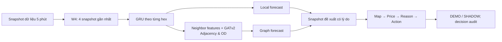

<!-- generated-by: gsd-doc-writer -->
# Báo cáo tóm tắt cho Stakeholder — Graph Surge Pricing

**Đối tượng:** Pricing/Ops và quản lý sản phẩm  
**Trạng thái:** khuyến nghị chuẩn bị cho giai đoạn shadow/A-B, **chưa sẵn sàng triển khai production**  
**Contract đã chốt:** W4, H5, `y = log((D+1)/(S_eff+1))`, inverse `exp`

## 1. Executive Summary

Dự án xây dựng một lớp hỗ trợ quyết định cho surge pricing theo từng vùng H3: dự báo áp lực cung–cầu 5 phút tới, sau đó trình bày đề xuất điều chỉnh trên **bidding hiện có** để Pricing/Ops xem xét. Bidding không bị thay thế; hệ thống mới chỉ là một lớp forecast và đề xuất có giải thích.

Động lực là trạng thái cung–cầu của một vùng thường chịu ảnh hưởng đồng thời từ diễn biến gần đây tại vùng đó và từ các vùng kết nối qua địa lý/luồng di chuyển. Cách nhìn theo từng vùng đơn lẻ có thể bỏ lỡ tín hiệu mạng; tuy nhiên, không có bằng chứng trong repository rằng bidding hiện hành thiếu hiệu quả hay rằng forecast tốt hơn sẽ tự động tạo ra uplift kinh doanh.

Giải pháp được thiết kế theo hai tầng: GRU tóm tắt chuỗi bốn snapshot gần nhất của từng vùng; nhánh graph dùng GATv2 kết hợp các liên kết kề nhau và OD để bổ sung bối cảnh mạng. Hai forecast local/graph là đầu vào dự kiến cho policy Pressure/Relative Graph Revision ở bước sau. Frontend định hướng một workspace nơi người vận hành đi theo luồng **bản đồ → giá/đề xuất → lý do/bằng chứng → hành động**.

| Chỉ dấu | Bằng chứng hiện có | Diễn giải đúng phạm vi |
|---|---|---|
| Dataset hiện hành | 30 ngày, 61 hex, 8.640 snapshot/5 phút; fingerprint `479e456d…` | Dữ liệu synthetic `balanced_peaks`, đã qua kiểm tra integrity/feature; chưa đại diện thị trường thực |
| Contract mô hình | W4, H5, node40/edge10, `gru_local37`/`gru_gatv2_40` | Quyết định thiết kế đã chốt cho lần chạy tiếp theo |
| Benchmark lịch sử | `gru_gatv2_40` validation MAE_q 0,3148; `gru_pointwise40` 0,3161 | Một seed trên **dataset cũ**, không phải bằng chứng cho `CURRENT` |
| Final test / business KPI | Chưa có | Không được suy diễn readiness, uplift hay hiệu quả policy |
| UX | Luồng và acceptance criteria đã đặc tả | Mục tiêu 10 giây tìm vùng, 30 giây giải thích đề xuất **chưa được đo** |

Các insight chính:

- Graph là giả thuyết cần kiểm chứng, không phải mặc định tốt hơn local model. Chênh lệch benchmark lịch sử giữa `gru_gatv2_40` và `gru_pointwise40` rất nhỏ.
- Target smoothed D/S xử lý hữu hạn khi demand hoặc effective supply bằng 0; lợi ích dự báo so với raw ratio vẫn cần được kiểm chứng.
- Forecast và quyết định giá phải tách rời: metric forecast không chứng minh correction tạo tác động nhân quả lên marketplace.
- Dataset hiện tại có kiểm tra kỹ thuật đạt, nhưng là synthetic và manifest ghi rõ chưa deployment-ready.
- UI phải giữ tính trung thực vận hành: DEMO/SHADOW không được diễn đạt như hệ thống đang thực thi giá thật.

**Khuyến nghị:** chưa deploy. Trước hết khóa artifact theo fingerprint `CURRENT`, chạy lại benchmark đa seed và final test một lần theo protocol, rồi nối policy/controller qua shadow read-only. Chỉ sau khi có kiểm chứng forecast, policy safety và usability mới xem xét A/B test được kiểm soát.

## 2. Background and Objectives

Hiện tại, bidding được xem là giá nền. Module mới được đặt để giúp đội Pricing/Ops quan sát rõ hơn vùng nào có áp lực cung–cầu dự kiến thay đổi trong 5 phút tới, vì sao có đề xuất, và liệu có nên chấp thuận/giữ nguyên/điều chỉnh có lý do. Phạm vi không bao gồm tối ưu GMV, causal estimation, tự động thay bidding hay cam kết lợi nhuận.

Mục tiêu business là giảm mơ hồ khi đánh giá đề xuất điều chỉnh pricing theo vùng. Mục tiêu kỹ thuật là dự báo một proxy D/S nhất quán, có thể audit theo cutoff, và so sánh công bằng giá trị tăng thêm của thông tin graph. KPI chính trong giai đoạn này là forecast level/ranking trên dữ liệu giữ lại; guardrail là correctness của contract, freshness/validity, độ an toàn số học, và khả năng giải thích/audit. Uplift doanh thu, completion hoặc cân bằng marketplace chỉ là KPI cho thử nghiệm sau này, không phải kết quả đã có.

## 3. Proposed Method

**Input và output.** Mỗi vùng nhận lịch sử W4 (bốn mốc cách nhau 5 phút) và dự báo H5 (5 phút tới). Model dùng 40 node features và 10 edge attributes; nhánh local dùng 37 feature, nhánh graph mới nhận thêm ba aggregate từ vùng lân cận. Output forecast ở cùng một thang đo D/S smoothed, sau đó inverse bằng `exp`.

**Lý do có GRU và GNN.** GRU học nhịp thay đổi ngắn hạn trong một vùng. GATv2 bổ sung tín hiệu từ vùng kề nhau và OD, hữu ích nếu chuyển động xuyên vùng thực sự cải thiện dự báo. Hai nhánh được giữ để vừa có baseline local dễ đối chiếu, vừa đo được giá trị thực của message passing thay vì gán mọi cải thiện cho GNN.

**Lớp quyết định và UI.** Post-processing Pressure và Relative Graph Revision đã được triển khai để tạo correction có direction gate và giới hạn requested ±0,4 điểm surge ở chế độ DEMO/SHADOW. Controller chưa được calibration và không có quyền thực thi production. Frontend không tự tính policy production: nó nhận snapshot đã version từ backend, cho phép xem trạng thái, lý do, dữ liệu hỗ trợ và hành động phù hợp theo mode. DEMO chỉ mô phỏng; SHADOW không gửi thay đổi giá.

**Giới hạn đã biết.** Forecast graph không đo network causal effect. Policy không có label “optimal surge”; vì vậy không được backprop hay diễn giải model như máy tối ưu giá. Live API, execution lifecycle và production acceptance cũng chưa phải bằng chứng sẵn có.

## 4. Results and Analysis

### Quan sát đã có

- Dataset `CURRENT` trỏ tới `hcm_mock_v2_30d_seed42_balanced_peaks`: 30 ngày từ 05/01 đến 04/02/2026, 61 hex, 527.040 hàng feature và khoảng 7,95 triệu graph edges. Manifest ghi `raw_integrity_pass`, `feature_integrity_pass` và `clean_validation_pass` là true.
- Dataset vẫn là mô phỏng. Manifest nêu rõ các giả định synthetic, thiếu calibration với vận hành TP.HCM thực, và cờ `deployment_ready=false`, `realism_validation_complete=false`.
- Báo cáo training ngày 10/09 lưu benchmark validation seed 42 trên dataset trước đó `hcm_mock_v2_30d_seed42`, không phải dataset `CURRENT`. Trong benchmark này, `gru_gatv2_40` có MAE_q 0,3148, tốt hơn nhẹ `gru_pointwise40` 0,3161; `gru_gatv2_40_no_adj` chưa hoàn tất.
- Final test chưa chạy. Vì vậy, con số trên chỉ là bằng chứng lịch sử một seed để định hướng thí nghiệm, không phải performance release hay cơ sở so sánh business.

### Ý nghĩa cho Pricing/Ops

Kết quả lịch sử cho thấy giả thuyết graph đáng kiểm chứng tiếp, nhưng chưa đủ mạnh để quyết định sản phẩm: gain tuyệt đối nhỏ và chưa được lặp lại theo seed/dataset. Giá trị gần hạn của sản phẩm vì vậy là tạo luồng review minh bạch hơn, không phải tự động tăng/giảm surge.

Với UI, đặc tả yêu cầu người dùng bắt đầu bằng map/queue, nhìn “bidding hiện tại → đề xuất sau giới hạn”, đọc một lý do ngắn rồi mở bằng chứng khi cần trước khi hành động. Đây là thiết kế phù hợp với công việc Pricing/Ops, nhưng không có dữ liệu usability, build/test browser pass hay UI acceptance để tuyên bố đã sẵn sàng.

### Các rủi ro cần kiểm soát

- **Reproducibility:** training history dùng fingerprint/dataset khác `CURRENT`; mọi metric mới phải ghi dataset fingerprint, feature order, transform và checkpoint version.
- **Time split:** warm-up `a+14` đã có trong pipeline W4, nhưng dataset `CURRENT` chưa được prepare và benchmark lại theo contract đã khóa; chưa coi đây là bằng chứng release mới.
- **Policy safety:** q reference, threshold, gain, global limits, invalid/stale fallback và audit phải được validation trước khi action thay đổi giá có thể được bật.
- **UX/integration:** server là authority cho eligibility, version conflict, idempotency và execution receipt; UI không được che lỗi bằng giá trị mặc định.

## 5. Conclusion

Dự án có một nền tảng kỹ thuật hợp lý để nghiên cứu forecast D/S theo mạng: contract W4–H5 rõ ràng, target ổn định với dữ liệu thưa, baseline local để kiểm chứng GNN và một UX flow hướng tới review có giải thích. Dataset hiện hành đã được kiểm tra ở tầng data, nhưng không phải dữ liệu thị trường thực; kết quả model hiện có cũng chưa gắn với dataset đó.

**Quyết định đề xuất:** đi theo lộ trình **shadow/A-B readiness**, chưa production deploy.

1. Đồng bộ toàn bộ config/artifact theo contract đã chốt và fingerprint `CURRENT`; tạo lại derived data/sample index với guard thời gian.
2. Chạy benchmark đầy đủ nhiều seed cho persistence, local/pointwise và graph ablations; chọn model bằng validation rồi chạy final test đúng một lần.
3. Thực hiện controller safety tests và xây dựng read-only/shadow snapshot có reason, validity, version và audit.
4. Kiểm thử usability với Pricing/Ops theo hai nhiệm vụ: nhận ra vùng cần review và giải thích đề xuất; đo mục tiêu 10/30 giây trước khi cân nhắc A/B.
5. Chỉ đưa execution vào phạm vi sau khi có phê duyệt business, policy calibration, backend lifecycle và guardrail theo dõi rõ ràng.

## Appendix — Contract và nguồn bằng chứng

### Contract đã khóa

- **Window:** W4 = `t−15, t−10, t−5, t`.
- **Horizon:** H5 = dự báo tại `t+5` phút.
- **Target:** `y = log((D+1)/(S_eff+1))`; **inverse:** `q = exp(y)`.
- **Effective supply:** `S_eff = idle + arrivals_0_5 + 0.5×arrivals_5_10 + 0.2×arrivals_10_15`.
- **Mô hình đối chiếu:** persistence, `gru_strict32`, `gru_local37`, `gru_pointwise40`, `gru_gatv2_40` và các ablation theo loại cạnh.

### Ranh giới phát biểu

- “Đã quan sát” chỉ áp dụng cho manifest/checks của dataset hiện hành và bảng validation lịch sử được dẫn nguồn dưới đây.
- “Đề xuất” áp dụng cho kiến trúc, controller, workflow UI, KPI usability và bước rollout.
- Không có kết luận nào trong báo cáo này về business uplift, production readiness, final-test performance, live API, controller calibration hay UI acceptance.

### Nguồn

- [Technical Report](../model/technical_report.md)
- [Frontend Spec — Surge Control](../frontend/frontend_spec.md)
- [ML Pipeline README](../ml_pipeline/README.md)
- [Training Summary 1009](../ml_pipeline/TRAINING-SUMMARY-1009.md)
- [CURRENT dataset pointer](../../data/CURRENT.json) và [dataset manifest](../../data/hcm_data_2/meta/manifest.json)
