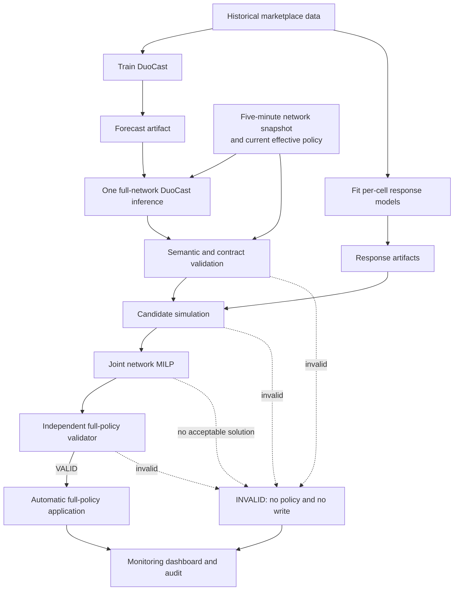

# Architecture — Current Repository and GGSO Target

Sources: [technical-report register](../technical_report/README.md), active CLI/configuration, backend documentation, and the current English report. The current implementation and target design are intentionally separated below.

## 1. Current repository

```text
Point-in-time market + geo + spatial + physical-driver mobility
  -> surge_ml.geomobinet (default CLI)
  -> pred_demand + pred_idle_supply + ds_proxy

Legacy pipeline/controller -> precomputed proposals
  -> backend DEMO/REPLAY -> legacy operator decisions and audit

Current network console -> legacy/demo consumer contract
```

GeoMobiNet-SMG currently includes a static-geo branch. Legacy backend/UI paths include per-hex actions. Neither is evidence that the no-geo DuoCast model or automatic GGSO full-policy execution is already integrated or active.

## 2. GGSO target design



Every five minutes, GGSO freezes one complete snapshot, forecasts the required network once, evaluates candidates, solves the coordinated policy, and independently validates the result. A VALID policy is applied automatically. An INVALID run issues no write, so current effective prices remain unchanged.

The dashboard is a monitoring interface. It displays the H3 network, observed and forecast demand/supply, current/recommended/applied multipliers, validation errors, execution status and history. It has no Accept Selected, Accept All, manual override or approval action in the target design.

## 3. DuoCast boundary

DuoCast contains a shared Temporal GRU, Spatial GATv2 over H3 adjacency, directed Mobility GATv2 over observed physical-driver movement, gated residual fusion, and independent demand/effective-supply heads. It has no Geo Encoder and no static geographic-feature input.

Demand is confirmed valid booking requests over the next five-minute interval. Supply is the online, idle, dispatch-eligible driver stock at `t+5`; it is distinct from effective service capacity `K`. History length `T` is configurable. The current `geomobinet_smg` model and checkpoint cannot be relabeled as DuoCast without an architecture-compatible adaptation or retraining and dataset/code/checkpoint parity evidence.

## 4. Module boundaries

Forecasting estimates the reference demand/supply state and does not run once per pricing candidate. Response models evaluate cell-level price response using fitted pre-decision context. Candidate simulation keeps capacity, fare and context fixed across candidates. The MILP selects one candidate per required cell and never calls the GNN or refits a response model.

Forecast spatial/mobility graphs and the pricing adjacency graph have different roles. The directed mobility graph must not silently replace the graph used for pricing smoothness penalties.

Forecast, response, candidate/policy, validation, execution and API schemas require independent version identities. One decision uses one cutoff, horizon, required node set and semantic profile throughout.

## 5. Integration gates

| Boundary | Gate |
|---|---|
| GeoMobiNet -> DuoCast | Remove static-geo dependency or provide a separately verified no-geo model; verify labels, code, checkpoint, ordering and node mapping |
| Response -> candidate | Complete eligible coefficients, preprocessing, scenarios and context for every required cell |
| Candidate -> MILP | Complete candidate table, fixed compatible `Q`, common monetary units and versioned policy parameters |
| MILP -> validator | Recompute full coverage, exact selections, bounds, Booking Rate and nominal network no-loss independently |
| Validator -> execution | Only the exact VALID full-network policy may be submitted; INVALID means no write |
| Execution -> next cycle | Use confirmed effective prices from a fresh snapshot; never assume a pending request is effective |
| GGSO -> dashboard | Monitoring-only contract; no human pricing actions |

One invalid required cell invalidates the run. GGSO never optimizes a partial network and fills the remainder with old prices. The incumbent platform state remaining unchanged after failure is a consequence of no write, not a generated fallback policy.

## 6. Activation boundary

This document specifies the target architecture. The repository's current DEMO/REPLAY services, legacy UI and test fixtures remain unchanged until a separately authorized implementation task migrates the contracts and execution path. Documentation alignment alone does not enable live price publication.
